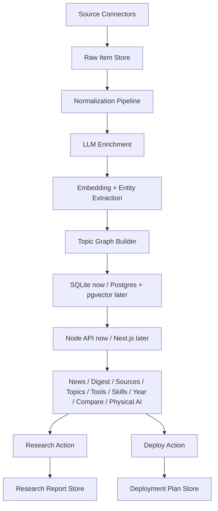

# Eagleye 架构设计文档

版本：v1.0  
日期：2026-05-28  
目标：完整复刻 OrangeBot.AI 的信息聚合、归档、前端展示和主要功能，并在其基础上增加 LLM 驱动的信息重塑、深度研究、一键部署、动态 Topics 知识图谱。

## 1. 背景与目标

Eagleye 要做成一个面向 AI、开发者、创业者和技术研究者的信息雷达。基准产品是 OrangeBot.AI。必须复刻它目前公开展示的全部核心板块：

- News
- Daily Digest
- Topics
- Sources
- Tools
- Skills
- By Year
- Compare
- Physical AI

在复刻基础上，Eagleye 必须新增三类能力：

1. LLM 信息重塑：每条信息源不仅展示原始标题、链接和元数据，还必须由 LLM 生成可信、结构化、可检索的 AI 总结。
2. 深度研究按钮：每条信息卡都提供“深度研究”动作，系统自动生成并执行一段针对该信息源的研究提示词，输出可保存的深度研究报告。
3. 一键部署按钮：当信息源是高星 GitHub 项目或包含可部署代码仓库时，系统自动生成部署提示词和部署计划，必要时生成可执行脚本或交给外部 agent 执行。
4. Live Topics：Topics 不再是静态主题列表，而是由所有信息源自动聚合、自动分类、自动长出 tag 和边关系的动态知识图谱。用户能从任意 topic/tag 进入相关信息群、时间线和子领域演进。

## 2. 已确认的 OrangeBot 基准事实

以下事实来自 2026-05-28 对公开页面和公开 JSON/RSS/API 的核验：

- 首页定位是“daily AI & tech news aggregator”，按每日 Issue 展示，顶部有文本视图、日期切换、导航、Hero、来源锚点和每日来源分区。
- 公开导航包含 News、Daily Digest、Topics、Sources、Tools、Skills、By Year、Compare、Physical AI。
- 主要聚合来源包括 Hacker News、GitHub Trending、Product Hunt、Hugging Face、Techmeme、Solidot、Startup Archive、App Store Rankings/App Store Trend。
- `Sources` 页列出每个来源的说明、来源页和 Atom Feed。
- `Topics` 当前是静态 topic index，包含 LLMs & Generative AI、AI & Machine Learning、AI Coding Tools、Security、Web Development、DevOps & Infra、Startups、Robotics、Crypto & Web3、Design。
- `Daily Digest` 当前提供最近 30 天归档，并可跳转 By Year、Topics、Sources、RSS。
- `Tools` 页展示 33 个工具、6 个大类，强调本地运行、免登录、无上传。
- `Skills` 页展示约 2,000 个 Claude Code Skills，包含分类、安装量、GitHub stars、作者、标签、安装命令和来源筛选。
- `By Year` 页按年份入口展示年度归档，并要求年页按 source、month、ISO week 组织。
- `Compare` 页提供决策框架、用户 persona 矩阵和竞品对比页。
- `Physical AI` 页是专项情报流，按 arXiv Physical AI papers、US semi SEC 8-K filings、humanoid company news、CN photonics 公告流分区。
- 公开接口形态包括 `/api/source/{source}?date=yyyymmdd`，返回 `exists` 和 `data`；GitHub Trending 数据包含 `repo_name`、`visit_github`、`stars`、`forks`、`language`；HN 数据包含 `title`、`url`、`hnUrl`、`points`、`comments`、`source`；Product Hunt 数据包含 `name`、`tagline`、`url`、`rank`、`votes`；Hugging Face 数据包含 `title`、`description`、`url`、`upvotes`、`pub_day/pub_date`；Solidot 数据包含中文 `title`、`description`、`url`、`pub_date`。

## 3. 产品原则

Eagleye 不能只是 RSS 阅读器。它应该是“原始信号 + AI 理解 + 研究行动 + 知识图谱”的工作台。

不可妥协要求：

- 信息源必须可追溯：每条 AI 总结必须保留原始 URL、来源、抓取时间、原文摘要、AI 版本、模型版本和置信度。
- 页面结构必须完整复刻 OrangeBot 的板块和体验：日刊、来源、主题、年度、对比、工具、技能、Physical AI 都要有。
- 每条信息都必须支持三层阅读：快读卡片、AI 总结、深度研究。
- GitHub 项目必须支持部署判断：只有当仓库可部署且星标达到阈值时，才展示“一键部署”主按钮；否则展示“生成部署分析”。
- Topics 必须是动态知识图谱，不允许只写死静态 topic 列表。
- 归档必须永久稳定：每个日期、来源、topic、year、item 都有可分享 URL。

## 4. 技术栈建议

### 4.1 当前项目基线

当前项目路径：`/Users/chillbit/Proj/eagleye`

现有实现不是空项目，Gemini 必须在此基础上演进：

- 后端：`server.js`，原生 Node.js `http` server，静态文件服务 + API。
- 数据库：`better-sqlite3`，本地 `eagleye.db`。
- 前端：`index.html` + `css/style.css` + ES modules under `js/modules/*`。
- 已有 API：`/api/items`、`/api/categories`、`/api/research`、`/api/graph`、`/api/sync`、`/api/sync/get`、`/api/sync/set`、`/api/health`。
- 已有表：`user_data`、`items`、`entities`、`item_entities`、`research`。
- 已有抓取：HN、V2EX、Lobsters、Hugging Face、GitHub Search。
- 已有 AI：`GEMINI_API_KEY` + Gemini 2.0 Flash，用于分类、标签、总结、实体抽取和深度研究。
- 已有前端功能：分类 tabs、搜索、同步按钮、深度研究 modal、简易知识图谱 overlay。

因此第一阶段不要推倒重写。先扩展当前 Node/SQLite 架构，把 OrangeBot 的页面、归档、来源、AI 总结、topic graph 数据模型补齐。只有当功能稳定、数据规模超出 SQLite/单文件 server 承载能力后，再迁移到 Next.js/Postgres。

### 4.2 推荐演进路线

短期落地栈：

- Web：保留现有 HTML/CSS/ES modules，增加真实路由兼容和页面渲染模块。
- API：继续扩展 `server.js`，但拆分为 `server/routes/*`、`server/connectors/*`、`server/services/*`。
- 数据库：继续使用 SQLite，但扩展 schema；新增迁移脚本，不要直接在 `server.js` 里无限追加 DDL。
- LLM：保留 Gemini provider，同时抽象 `LLMProvider`，后续可接 OpenAI/Claude。
- 图谱：SQLite 边表起步，前端先用现有 overlay 升级为 topic graph；后续可替换为 Sigma.js/Cytoscape.js。
- 后台任务：保留 `/api/sync`，新增 job 表和可重跑脚本。
- Feed 输出：在 Node server 内生成 Atom XML + JSON Feed。

中长期目标栈：

- Web：Next.js App Router + React + TypeScript
- 样式：Tailwind CSS，复刻 OrangeBot 的 editorial/terminal/kiosk 风格
- 数据库：PostgreSQL + pgvector
- ORM：Drizzle ORM
- 后台任务：Inngest 或 Trigger.dev；本地开发可先用 `tsx scripts/jobs/*.ts`
- 队列：Postgres job table 起步，后续可换 Redis/BullMQ
- 抓取：RSS Parser、Cheerio、Playwright、官方 API
- LLM：统一 `LLMProvider` 抽象，支持 OpenAI/Gemini/Claude 任一 provider
- Embedding：统一 `EmbeddingProvider` 抽象，写入 pgvector
- 图谱：Postgres 边表 + pgvector 混合；前端用 Sigma.js 或 Cytoscape.js 渲染知识图谱
- 时间线：ECharts、visx 或自研轻量 timeline
- Feed 输出：Atom XML + JSON Feed
- 部署：Vercel + Supabase/Neon；后台任务使用 Vercel Cron 或 Trigger.dev

不建议第一版直接上 Neo4j。当前 SQLite 的 `topics`、`tags`、`entities`、`graph_edges` 足够实现 live topic graph 的 MVP；迁移到 Postgres 后再启用 pgvector。如果图查询复杂，再考虑 Neo4j。

## 5. 顶层架构



核心流水线：

1. Connector 抓取各来源原始数据。
2. Normalizer 将不同来源统一成 `information_items`。
3. LLM Enricher 生成 AI 标题、摘要、要点、影响、风险、适合人群、行动建议。
4. Entity Extractor 提取公司、产品、模型、论文、GitHub repo、人物、机构、技术词。
5. Embedding 写入 item、summary、topic、entity 向量。
6. Topic Graph Builder 自动创建或更新 topic、tag、entity 和边。
7. Web 前台按页面读取稳定数据。
8. 用户点击“深度研究”或“一键部署”触发动作任务。

## 6. 数据模型

### 6.1 sources

```sql
sources (
  id uuid primary key,
  slug text unique not null,
  label text not null,
  description text not null,
  homepage_url text,
  feed_url text,
  connector_type text not null,
  is_active boolean default true,
  refresh_cron text,
  created_at timestamptz default now(),
  updated_at timestamptz default now()
)
```

必须内置 sources：

- `hacker-news`
- `github-trending`
- `product-hunt`
- `hugging-face`
- `techmeme`
- `solidot`
- `startup-archive`
- `app-store-rank`
- `app-store-trend`
- `physical-ai-arxiv`
- `physical-ai-sec-8k`
- `physical-ai-humanoid`
- `physical-ai-cn-photonics`

### 6.2 information_items

```sql
information_items (
  id uuid primary key,
  source_id uuid references sources(id),
  canonical_url text not null,
  external_id text,
  title text not null,
  original_summary text,
  content_text text,
  language text,
  author text,
  published_at timestamptz,
  fetched_at timestamptz default now(),
  digest_date date not null,
  source_payload jsonb not null,
  normalized_payload jsonb not null,
  score numeric default 0,
  popularity jsonb,
  content_hash text,
  duplicate_group_id uuid,
  created_at timestamptz default now(),
  updated_at timestamptz default now(),
  unique(source_id, canonical_url, digest_date)
)
```

来源特有字段放入 `source_payload`：

- HN：points、comments、hnUrl、domain
- GitHub：repo_name、owner、repo、stars、forks、language、description、topics、license
- Product Hunt：name、tagline、rank、votes、icon_url
- Hugging Face：paper/model/dataset 类型、upvotes、pub_day、description
- Solidot：中文 title/description、sid
- App Store：app_id、country、rank、category、trend

### 6.3 ai_summaries

```sql
ai_summaries (
  id uuid primary key,
  item_id uuid references information_items(id),
  model_provider text not null,
  model_name text not null,
  prompt_version text not null,
  ai_title text,
  one_liner text not null,
  short_summary text not null,
  deep_summary text,
  key_points jsonb not null,
  why_it_matters text,
  audience text[],
  risks text[],
  opportunities text[],
  action_items text[],
  confidence numeric,
  source_grounding jsonb,
  created_at timestamptz default now()
)
```

每条 item 至少要生成：

- `one_liner`：一句话判断
- `short_summary`：80-160 字中文摘要
- `key_points`：3-5 条要点
- `why_it_matters`：为什么值得关注
- `audience`：适合谁读
- `risks`：潜在风险或不确定性
- `opportunities`：可行动机会

### 6.4 topics、tags、entities、graph_edges

```sql
topics (
  id uuid primary key,
  slug text unique not null,
  name text not null,
  description text,
  parent_topic_id uuid references topics(id),
  status text default 'active',
  auto_generated boolean default true,
  confidence numeric,
  centroid_embedding vector(1536),
  first_seen_at timestamptz,
  last_seen_at timestamptz,
  growth_score numeric default 0,
  created_at timestamptz default now(),
  updated_at timestamptz default now()
)

tags (
  id uuid primary key,
  slug text unique not null,
  name text not null,
  type text not null,
  created_at timestamptz default now()
)

entities (
  id uuid primary key,
  canonical_name text not null,
  type text not null,
  aliases text[],
  url text,
  metadata jsonb,
  embedding vector(1536),
  created_at timestamptz default now(),
  updated_at timestamptz default now()
)

item_topics (
  item_id uuid references information_items(id),
  topic_id uuid references topics(id),
  relevance numeric not null,
  reason text,
  assigned_by text not null,
  created_at timestamptz default now(),
  primary key (item_id, topic_id)
)

item_tags (
  item_id uuid references information_items(id),
  tag_id uuid references tags(id),
  confidence numeric,
  created_at timestamptz default now(),
  primary key (item_id, tag_id)
)

graph_edges (
  id uuid primary key,
  from_type text not null,
  from_id uuid not null,
  to_type text not null,
  to_id uuid not null,
  edge_type text not null,
  weight numeric not null default 1,
  evidence_item_ids uuid[],
  first_seen_at timestamptz,
  last_seen_at timestamptz,
  created_at timestamptz default now(),
  updated_at timestamptz default now()
)
```

边类型必须支持：

- `item_mentions_entity`
- `item_belongs_topic`
- `topic_related_topic`
- `entity_related_entity`
- `tag_related_topic`
- `repo_implements_topic`
- `paper_advances_topic`
- `product_targets_topic`
- `source_discusses_topic`

### 6.5 research_reports

```sql
research_reports (
  id uuid primary key,
  item_id uuid references information_items(id),
  user_id uuid,
  status text not null,
  prompt text not null,
  report_markdown text,
  citations jsonb,
  model_provider text,
  model_name text,
  error text,
  created_at timestamptz default now(),
  completed_at timestamptz
)
```

### 6.6 deployment_plans

```sql
deployment_plans (
  id uuid primary key,
  item_id uuid references information_items(id),
  repo_url text not null,
  repo_stars integer,
  status text not null,
  eligibility text not null,
  prompt text not null,
  plan_markdown text,
  commands jsonb,
  env_vars jsonb,
  detected_stack jsonb,
  risk_notes text[],
  created_at timestamptz default now(),
  completed_at timestamptz
)
```

## 7. 页面和路由规格

### 7.1 全局导航

所有主页面都必须保留统一导航：

```txt
News | Daily Digest | Topics | Sources | Tools | Skills | By Year | Compare | Physical AI
```

还要保留 Footer 分组：

- Read：News、Blog、Daily Digest、Topics、Sources、By Year
- Make：Tools、Skills、Compare、Saved
- Company：About、FAQ、Privacy、Terms
- Follow：X、Substack、RSS、JSON Feed

### 7.2 News：`/` 和 `/news`

目标：复刻 OrangeBot 首页“每日 issue + 多来源 digest”的体验，并增强每条信息卡的 AI 操作。

页面结构：

1. SSR 文本视图：折叠区域，按来源列出当天条目，适合 SEO 和快速复制。
2. 顶部 Issue Header：issue number、日期、Change Date。
3. Hero：产品定位、来源数量、工具数量、技能数量、入口按钮。
4. 新功能提示条：例如 Chrome extension 或 Eagleye 的新能力。
5. Sticky section nav：AI Digest、Hacker News、HuggingFace、GitHub Trending、Product Hunt、Techmeme、Startup Archive、Solidot、App Store Rank、App Store Trend。
6. AI Digest：LLM 从当天所有 source 中生成总览，包括 Top Signals、Emerging Topics、Repo Watch、Paper Watch、Product Watch、Risk Watch。
7. 各来源分区：每个来源展示卡片列表。

信息卡必须包含：

- 原始标题
- 来源、日期、排名/分数/星标/评论等来源元数据
- 原始链接
- AI 一句话
- AI 短摘要
- tags/topics
- Save
- 深度研究按钮
- 一键部署按钮或部署分析按钮

GitHub 卡片额外展示：

- stars、forks、language、license
- 最近增长趋势
- 是否可部署：`deployable | maybe | no`
- README/包管理器/容器文件检测结果

### 7.3 Daily Digest：`/digest`、`/digest/[date]`

`/digest`：

- 最近 30 天 issue 列表
- Today、Yesterday、N days ago 标签
- Longer-range roll-ups：By Year、By Topic、By Source

`/digest/[date]`：

- 固定日期页面
- 和 News 相同的信息结构，但数据固定到 date
- 可导出 Markdown、JSON Feed、Atom
- 展示当天的 topic 增长、source 覆盖、AI 总结版本

### 7.4 Topics：`/topics`、`/topics/[slug]`

这是 Eagleye 最核心增强点。

`/topics` 不再只是静态列表，必须是三栏工作台：

1. 左栏：topic tree/topic index
2. 中间：interactive live knowledge graph
3. 右栏：选中 topic/tag/entity 的详情、时间线、关联 items

Topic index 要保留 OrangeBot 的初始主题作为 seed：

- LLMs & Generative AI
- AI & Machine Learning
- AI Coding Tools
- Security
- Web Development
- DevOps & Infra
- Startups
- Robotics
- Crypto & Web3
- Design

但这些只作为初始 seed。后续系统每天自动扩展：

- 新主题：当一批 items 在 embedding 空间中聚类稳定、出现频率超过阈值、且不能很好归入现有 topic 时，创建候选 topic。
- 子主题：当一个 topic 内部出现稳定子簇时，生成 child topic。
- 标签：从 item 中抽取技术词、产品名、机构名、模型名、仓库名作为 tags/entities。
- 合并：相似 topic 自动进入 merge candidate，后台人工确认或高置信自动合并。
- 衰减：长期没有新 items 的 topic 降低 growth_score，但不删除。

`/topics/[slug]`：

- topic 介绍：自动摘要 + 人工可编辑描述
- graph neighborhood：一跳/二跳关联 topic、tag、entity
- timeline：按日/周/月展示 topic 下 items 的演进
- source mix：来源分布
- top items：按时间、热度、relevance 排序
- related repos/papers/products
- “研究这个 topic”按钮：对整个 topic 进行深度研究
- “订阅 topic”按钮：RSS/JSON/email/webhook

### 7.5 Sources：`/sources`、`/sources/[slug]`

`/sources`：

- 复刻 OrangeBot 的 source index
- 每个 source 展示描述、source page、feed URL
- 展示今日条目数、最近更新时间、历史总量、主题覆盖

`/sources/[slug]`：

- About source
- Latest items
- Atom feed
- JSON feed
- Source-specific filters
- 该 source 的 topic 分布
- 该 source 的 AI digest

### 7.6 Tools：`/tools`、`/tools/[slug]`

必须复刻工具目录体验，第一版至少实现 catalog、filter、工具详情页。工具本体可以按优先级逐步补齐，但页面和路由必须完整。

目录分类：

- Image Tools：Image Compressor、Image Resizer、Image Converter、HEIC to JPG、Image Cropper、Screenshot Beautify
- Video & Audio：Video Compressor、Video to GIF、Audio Compressor、Media Converter、Audio Extractor、Voice Recorder
- Developer Tools：JSON Formatter、Code Minifier、Base64 Encoder、QR Generator、Color Picker
- Documents & Utility：PDF Compressor、Unit Converter、Timezone Converter、ZIP Creator、Markdown Preview、LaTeX Preview
- More Tools：Chronograph、2FA Authenticator、Password Generator、App Stats、UTM Generator、IP Lookup、Peepbo
- Finance：Mortgage Calculator、HELOC Calculator、Leverage Calculator

工具页要求：

- 免登录
- 尽量本地运行
- 明确是否上传
- 每个工具有 stable slug 和 SEO metadata

### 7.7 Skills：`/skills`、`/skills/[id]`

复刻 OrangeBot 的 Claude Code Skills catalog。

目录能力：

- 分类浏览
- Top skills by weekly installs
- GitHub stars
- author/repo/source
- tags
- install command
- source filters
- search
- sort：weekly installs、stars、recently added、category

内置分类：

- Frontend、Backend、AI & Machine Learning、Automation、Architecture、Testing、Security、DevOps、Data、API、CLI Tools、Documentation、Performance、Code Quality、Mobile、Cloud、Database、Design Systems、Content、Research、Media、Finance、Browser、Full Stack

数据抓取：

- 从 GitHub 仓库搜索、awesome lists、公开 skill registry 或用户配置的 repo list 抓取
- 提取 `SKILL.md`、manifest、README、安装命令、stars、forks、last commit
- 生成 AI 摘要和适用场景

### 7.8 By Year：`/year`、`/year/[year]`

`/year`：

- 年份入口：2026、2025、2024 等

`/year/[year]`：

- 按 source 汇总
- 按 month 汇总
- 按 ISO week 汇总
- 年度 top topics
- 年度 top repos/products/papers
- 年度 AI trend report

### 7.9 Compare：`/compare`、`/compare/[competitor]`

复刻 OrangeBot 对比页结构：

- How to pick a daily tech news aggregator
- 决策维度：source coverage、dedup & clustering、AI summary quality、sign-up friction、export & portability、mobile experience
- Persona matrix：solo dev、AI researcher、indie hacker、founder/VC、non-technical reader、engineering team
- Side-by-side comparisons

竞品页至少支持：

- OrangeBot/Eagleye vs Hackertab
- OrangeBot/Eagleye vs Feedly
- OrangeBot/Eagleye vs Techmeme
- 后续可加 Daily.dev、Inoreader、Readwise Reader

### 7.10 Physical AI：`/physical-ai`

复刻 OrangeBot 的专项 brief，并增强 AI 供应链分析。

分区：

1. ARXIV · PHYSICAL AI PAPERS
2. US SEMI · SEC 8-K FILINGS
3. HUMANOID · COMPANY NEWS
4. CN PHOTONICS · 公告流

新增分析：

- physical AI topic graph
- silicon photonics/CPO/VLA/humanoid/embodied AI tag
- 公司/论文/供应链 entity
- 投资/产业链风险提示
- 时间线

## 8. LLM 信息重塑规格

### 8.1 总结 Prompt 模板

每条 item 抓取后运行：

```txt
你是 Eagleye 的技术情报分析员。请基于以下原始信息，生成可信、克制、可追溯的中文信息卡。

要求：
1. 不要编造原文没有的信息。
2. 如果信息不足，明确写“不确定”。
3. 保留技术名词、公司名、模型名、项目名。
4. 输出 JSON，不要输出 Markdown。
5. 总结要帮助开发者判断是否值得点开、收藏、研究或部署。

输入：
source: {{source_label}}
title: {{title}}
url: {{canonical_url}}
published_at: {{published_at}}
source_payload: {{source_payload_json}}
content_excerpt: {{content_excerpt}}

输出 JSON schema：
{
  "ai_title": "更清晰但不夸张的中文标题",
  "one_liner": "一句话判断",
  "short_summary": "80-160 字中文摘要",
  "key_points": ["3-5 条要点"],
  "why_it_matters": "为什么重要",
  "audience": ["适合哪些人"],
  "risks": ["风险或不确定性"],
  "opportunities": ["可行动机会"],
  "suggested_tags": ["标签"],
  "entities": [{"name": "实体名", "type": "company|repo|paper|model|person|product|technology|other"}],
  "confidence": 0.0
}
```

### 8.2 Daily AI Digest Prompt

```txt
你是 Eagleye 的每日技术情报主编。请基于今天所有信息源，生成一份中文 Daily AI Digest。

要求：
1. 按信号强度排序，不要按来源机械罗列。
2. 合并重复信息。
3. 标出新兴主题、异常增长、值得研究的 GitHub 项目、值得读的论文、值得试的产品、风险和噪声。
4. 每个判断都引用 item_id。
5. 输出 JSON。

输入：
date: {{digest_date}}
items: {{items_with_ai_summaries}}

输出：
{
  "headline": "今日最重要判断",
  "executive_summary": "300 字以内",
  "top_signals": [{"title": "", "reason": "", "item_ids": []}],
  "emerging_topics": [{"topic": "", "why_now": "", "item_ids": []}],
  "repo_watch": [{"repo": "", "why": "", "item_id": ""}],
  "paper_watch": [{"paper": "", "why": "", "item_id": ""}],
  "product_watch": [{"product": "", "why": "", "item_id": ""}],
  "risk_watch": [{"risk": "", "evidence": "", "item_ids": []}]
}
```

## 9. 深度研究按钮规格

每条信息卡都有“深度研究”按钮。

点击流程：

1. 创建 `research_reports` 记录，状态 `queued`。
2. 后台收集上下文：原始 item、AI summary、同 topic 近 30/90 天相关 items、实体、外部网页摘要。
3. 生成研究 prompt。
4. 调用 LLM 或外部研究 agent。
5. 输出 Markdown 报告，保存并展示。

### 9.1 单 item 深度研究 Prompt

```txt
你是 Eagleye 的深度研究员。请围绕下面这条信息源做一次严谨的技术/产业研究。

研究对象：
- 标题：{{title}}
- 来源：{{source_label}}
- URL：{{canonical_url}}
- 发布时间：{{published_at}}
- AI 摘要：{{short_summary}}
- 原始信息：{{content_text_or_excerpt}}
- 相关 topic：{{topics}}
- 相关实体：{{entities}}
- 近 90 天相关信息：{{related_items}}

研究目标：
1. 解释这条信息的真实含义，不要停留在标题层面。
2. 追溯背景：这个方向之前发生了什么。
3. 判断影响：对开发者、创业者、研究者、投资/产业链分别意味着什么。
4. 给出反面观点和不确定性。
5. 列出后续应该关注的关键词、项目、论文、公司或指标。
6. 给出可执行行动建议。

输出 Markdown：
# 研究结论
## 一句话结论
## 背景脉络
## 关键事实
## 影响分析
## 反面观点与不确定性
## 后续观察清单
## 行动建议
## 引用与证据

规则：
- 明确信息来自原文、历史相关 item，还是你的推理。
- 不要编造引用。
- 如果证据不足，要写明证据不足。
```

### 9.2 Topic 深度研究 Prompt

Topic 页也要有“研究这个 topic”：

```txt
你是 Eagleye 的专题研究员。请基于 topic 的知识图谱和时间线做专题研究。

Topic：{{topic_name}}
描述：{{topic_description}}
时间范围：{{from}} 到 {{to}}
相关 items：{{top_items}}
相关 entities：{{entities}}
图谱邻居：{{graph_neighbors}}
趋势数据：{{timeline_stats}}

请输出：
1. 这个 topic 当前处于什么阶段。
2. 最近有哪些新分支或新 tag 长出来。
3. 哪些公司/项目/论文是关键节点。
4. 时间线上出现了哪些转折点。
5. 未来 30/90 天要观察什么。
6. 对开发者/创业者/研究者的建议。
```

## 10. 一键部署按钮规格

### 10.1 展示规则

只有满足下列任一条件时展示“一键部署”主按钮：

- GitHub stars >= 5,000 且检测到明确部署入口
- GitHub Trending 项目且 README 中包含 Quickstart/Deploy/Docker/Installation
- 识别到 `package.json`、`Dockerfile`、`docker-compose.yml`、`pyproject.toml`、`requirements.txt`、`Makefile`、`README` 中的运行命令

否则展示：

- `生成部署分析`：输出是否可部署、缺什么、风险是什么。

### 10.2 部署检测

后台对 GitHub repo 做轻量检测：

- GitHub API 读取 repo metadata
- 获取 README、package files、Docker files
- 检测框架：Next.js、Vite、Node、Python、FastAPI、Streamlit、Docker、Go、Rust 等
- 检测环境变量：`.env.example`、README 中的 env var
- 检测 license
- 检测最近维护：last commit、issues、release
- 检测安全风险：未知 install script、需要外部 key、需要 GPU、需要 root、需要数据库

### 10.3 一键部署 Prompt

```txt
你是 Eagleye 的部署工程师。请为下面的 GitHub 项目生成一个可执行、保守、安全的部署计划。

Repo：
- URL：{{repo_url}}
- stars：{{stars}}
- forks：{{forks}}
- language：{{language}}
- description：{{repo_description}}
- license：{{license}}
- README 摘要：{{readme_excerpt}}
- 检测到的文件：{{detected_files}}
- package/config 摘要：{{package_summaries}}

目标：
1. 判断它是否真的适合一键部署。
2. 识别技术栈和运行方式。
3. 给出本地运行命令。
4. 给出 Docker 部署方案；如果项目已有 Dockerfile，优先使用；没有则说明如何补。
5. 给出 Vercel/Render/Fly.io/Railway 中最合适的平台建议。
6. 列出必要环境变量。
7. 列出安全风险和资源成本风险。
8. 不要执行危险命令，不要要求用户粘贴密钥。

输出 Markdown：
# 部署可行性
## 结论
## 技术栈判断
## 本地运行
## Docker 方案
## 云平台部署
## 环境变量
## 风险
## 下一步
```

如果后续要接入真实执行，按钮流程必须分两步：

1. 先生成部署计划。
2. 用户确认后再执行 clone/build/run/deploy。

## 11. Topic 知识图谱生成算法

### 11.1 每日图谱更新任务

任务：`build-topic-graph(date)`

输入：当天所有 `information_items` + `ai_summaries`

步骤：

1. 为每条 item 生成 embedding。
2. LLM 抽取 entities、tags、candidate_topics。
3. 用 embedding 与现有 topics centroid 做相似度匹配。
4. 如果相似度高于阈值，写入 `item_topics`。
5. 如果多个 item 形成新簇且无法归入现有 topic，创建 `topic_candidates`。
6. 根据共现、相似度、LLM 判断写入 `graph_edges`。
7. 更新 topic centroid、growth_score、first_seen_at、last_seen_at。
8. 生成 topic timeline stats。

### 11.2 Topic 创建规则

创建候选 topic 需要同时满足：

- 过去 14 天至少 5 个 items
- 至少 2 个不同 source
- embedding 聚类相似度高
- LLM 给出的 topic 名称稳定
- 不与现有 topic 高度重复

高置信自动创建，低置信进入后台审核。

### 11.3 Topic 生长指标

`growth_score` 建议：

```txt
growth_score =
  log(1 + items_last_7d) * 0.30
  + source_diversity_score * 0.20
  + average_item_score * 0.20
  + new_entity_count_last_7d * 0.15
  + graph_degree_delta * 0.15
```

Topic 页要展示：

- 最近 7/30/90 天 item 数
- source diversity
- top entities
- new tags
- graph degree growth
- timeline spikes

## 12. 信息源 Connector 设计

每个 connector 实现统一接口：

```ts
export interface SourceConnector {
  slug: string;
  fetch(date: string): Promise<RawSourceItem[]>;
  normalize(raw: RawSourceItem): Promise<NormalizedItem>;
}
```

### 12.1 Hacker News

策略：

- 优先 HN Firebase API 或 Algolia API
- 抓取 top stories / best stories
- 字段：title、url、hnUrl、points、comments、domain

### 12.2 GitHub Trending

策略：

- GitHub Trending 无官方 API，第一版可用 HTML 抓取 + GitHub API 补充 metadata
- 字段：repo_name、owner、repo、url、description、language、stars、forks、stars_today、license、topics

### 12.3 Product Hunt

策略：

- 优先官方 API；没有 key 时可抓取公开页面或使用用户配置
- 字段：name、tagline、url、rank、votes、icon_url、topics

### 12.4 Hugging Face

策略：

- 抓取 papers、models、datasets trending
- 字段：title、description、url、upvotes、pub_date、paper_id/model_id

### 12.5 Techmeme

策略：

- RSS/feed 或公开页面解析
- 字段：title、url、source_site、cluster links、published_at

### 12.6 Solidot

策略：

- RSS 或公开页面解析
- 中文信息保留原文；AI 总结可输出中文增强版

### 12.7 Startup Archive

策略：

- 抓取公开 archive/source
- 字段：title、url、author、company、topic、published_at

### 12.8 App Store Rank/Trend

策略：

- 使用 iTunes Search API、RSS Top Charts 或第三方可配置 provider
- 字段：app_id、name、developer、category、country、rank、rank_delta、rating、icon

### 12.9 Physical AI

ARXIV：

- arXiv API 查询关键词：physical AI、embodied AI、humanoid、robotics、VLA、vision-language-action、world model、sim2real、silicon photonics、CPO

SEC 8-K：

- SEC EDGAR API，关注半导体、光模块、机器人、传感器相关公司 CIK 列表

Humanoid company news：

- 公司 RSS、新闻页、PR Newswire、TechCrunch 等

CN photonics：

- 目标来源：巨潮资讯、上交所/深交所公告、公司官网公告、行业媒体 RSS

## 13. API 设计

核心 API：

```txt
GET /api/digest?date=yyyymmdd
GET /api/source/:slug?date=yyyymmdd
GET /api/sources
GET /api/topics
GET /api/topics/:slug
GET /api/topics/:slug/timeline
GET /api/topics/:slug/graph
GET /api/items/:id
GET /api/items/:id/summary
POST /api/items/:id/research
GET /api/research/:id
POST /api/items/:id/deployment-plan
GET /api/deployment-plans/:id
GET /feed.xml
GET /feed.json
GET /feed/:source
GET /topics/:slug/feed.xml
```

后台 job API：

```txt
POST /api/jobs/fetch-source
POST /api/jobs/enrich-item
POST /api/jobs/build-digest
POST /api/jobs/build-topic-graph
POST /api/jobs/rebuild-year-archive
```

## 14. 前端视觉要求

复刻 OrangeBot 的气质，但品牌命名改为 Eagleye：

- Editorial + terminal + builder workbench
- 宽版最大容器约 1720px
- Mono 小字号 uppercase metadata
- 强分割线、border、左侧竖线信息卡
- 浅色主题以米白/纸感为底；深色主题以深蓝黑为底
- 强调色可用橙色，但不要完全照搬 Logo/素材
- 首页必须是实际内容，不要做营销落地页
- Topic graph 必须是第一屏核心交互之一，不要藏在二级页
- 移动端必须可读：topic graph 在移动端切换为 list + mini graph

关键组件：

- `SiteNav`
- `Footer`
- `IssueHeader`
- `TextDigest`
- `SectionAnchorNav`
- `SourceSection`
- `InformationCard`
- `AISummaryBlock`
- `ResearchButton`
- `DeployButton`
- `TopicGraph`
- `TopicTimeline`
- `SourceFilterBar`
- `ToolCatalog`
- `SkillCatalog`
- `YearArchive`
- `CompareMatrix`
- `PhysicalAIBrief`

## 15. 后台任务编排

每日任务：

```txt
00:00-02:00 UTC: fetch all sources
02:00-03:00 UTC: normalize + dedupe
03:00-05:00 UTC: LLM enrich all new items
05:00-06:00 UTC: build topic graph
06:00-06:30 UTC: build daily digest
06:30-07:00 UTC: generate feeds and cache
```

任务必须可重跑：

- 同一 source/date 可重复抓取
- content_hash 防重复
- LLM summary 按 prompt_version/model_name 可重建
- topic graph 增量更新，不破坏旧归档

## 16. 去重与聚类

去重规则：

- canonical URL 相同：强去重
- 标题相似度 > 0.92 且 domain 相同：去重
- embedding 相似度 > 0.90 且发布时间接近：候选重复
- Techmeme cluster link 可作为重复组 evidence

重复组展示：

- 卡片显示主 item
- 展开后显示其它来源报道
- AI summary 基于主 item + cluster items 汇总

## 17. 权限和保存

匿名用户：

- 可读所有公开页面
- 可运行本地 tools
- 可生成有限次数研究/部署计划，或禁用写入

登录用户：

- Save item
- 保存 research report
- 保存 topic subscription
- 自定义 sources
- 自定义 digest

数据库：

```sql
saved_items (
  user_id uuid,
  item_id uuid,
  note text,
  created_at timestamptz default now(),
  primary key(user_id, item_id)
)
```

## 18. 实施里程碑

### Phase 1：基础复刻

- 保留当前 `server.js` + SQLite + 静态前端，不做框架迁移
- 新增数据库迁移脚本，并扩展 schema
- Sources seed，对齐 OrangeBot 来源，同时保留现有 V2EX/Lobsters 作为额外来源
- `/`、`/news`、`/digest`、`/sources`、`/topics`、`/year`、`/compare`、`/physical-ai` 静态/SSR 页面
- Feed XML/JSON
- HN、GitHub Trending、Hugging Face、Product Hunt、Solidot、Techmeme connector

验收：

- 首页能按日期展示多来源信息
- 每个 source 有来源页和 feed
- 最近 30 天 digest 可访问

### Phase 2：AI 信息重塑

- LLM provider 抽象
- per-item AI summary
- daily AI digest
- item tags/entities
- summary cache 和 prompt_version

验收：

- 每条信息卡有 AI 一句话、摘要、要点、why matters
- summary 可重跑且保留模型版本

### Phase 3：深度研究与一键部署

- research report job
- deployment plan job
- GitHub repo detector
- Research/Deploy 按钮和结果页

验收：

- 任意 item 可生成研究报告
- 高星 GitHub repo 可生成部署计划
- 不可部署 repo 能解释原因

### Phase 4：Live Topics 知识图谱

- embeddings
- topics/tags/entities/edges
- topic graph builder
- `/topics` 图谱工作台
- `/topics/[slug]` 时间线和图谱邻居

验收：

- 新信息能自动归类到 topic
- topic 可自动增长 tag/entity
- 用户能在 topic 图谱中定位一组相关信息，并按时间线查看进展

### Phase 5：Tools、Skills、Compare 完整化

- Tools catalog + tool detail pages
- Skills catalog + skill crawler
- Compare 子页面
- Year archive 完整聚合

验收：

- 所有 OrangeBot 主板块都有可用页面
- Skills 支持分类、搜索、排序
- Tools 至少 catalog 完整，核心工具可用

## 19. Gemini 执行指令

请 Gemini 严格按以下顺序实施：

1. 不要先做营销页，直接搭建真实应用。
2. 必须基于 `/Users/chillbit/Proj/eagleye` 当前项目演进，不要删除现有 `server.js`、`index.html`、`css/`、`js/`、`eagleye.db`。
3. 先把 `server.js` 中的数据库初始化、connectors、LLM、routes 逐步拆分为模块；如果改动太大，先保留兼容导出。
4. 先实现 SQLite schema migration 和 seed sources，再写页面。
5. 所有页面必须使用真实 URL 路径；当前 server 可继续 fallback 到 `index.html`，但前端要根据 pathname 渲染对应页面，不要只做单页假 Tab。
6. 首页先用现有数据和 mock data 通过组件验收，再接 connector。
7. Connector 返回统一 `NormalizedItem`，不要在页面里写来源特判。
8. AI summary 必须独立表存储，不能覆盖原始 `items.summary` 或原始抓取内容。
9. Research 和 Deploy 必须是异步 job 或可缓存任务，不要长期阻塞页面请求。
10. Topics 必须实现 graph 数据模型和图谱 API；即使第一版前端图简单，也不能只做静态 topic 列表。
11. 除非用户明确批准，不要迁移到 Next.js/Postgres；先把当前 Node/SQLite 版做完整。
12. 每个 Phase 完成后运行可用检查：`npm start`、`/api/health`、核心页面手动或脚本检查，并提交变更说明。

## 20. 完成定义

Eagleye v1 完成时必须满足：

- OrangeBot 的 9 个核心板块全部存在且可用。
- 每个来源都有抓取、归档、来源页和 feed。
- 每条 item 都有 AI 总结。
- 每条 item 都有深度研究入口。
- GitHub repo item 有部署分析/一键部署入口。
- Topics 是 live graph，能自动接收所有信息源、自动聚合、自动分类、自动生长 tag/entity。
- 任意 topic 可查看关联信息群和时间线。
- Digest、Source、Topic、Year 都有稳定 URL。
- 所有 AI 输出有 prompt_version、model_name、created_at 和 source grounding。

## 21. 参考页面

- OrangeBot 首页：https://orangebot.ai/
- Topics：https://orangebot.ai/topics
- Sources：https://orangebot.ai/sources
- GitHub Trending source：https://orangebot.ai/sources/github-trending
- Daily Digest：https://orangebot.ai/digest
- Tools：https://orangebot.ai/tools
- Skills：https://orangebot.ai/skills
- By Year：https://orangebot.ai/year
- Compare：https://orangebot.ai/compare
- Physical AI：https://orangebot.ai/physical-ai
